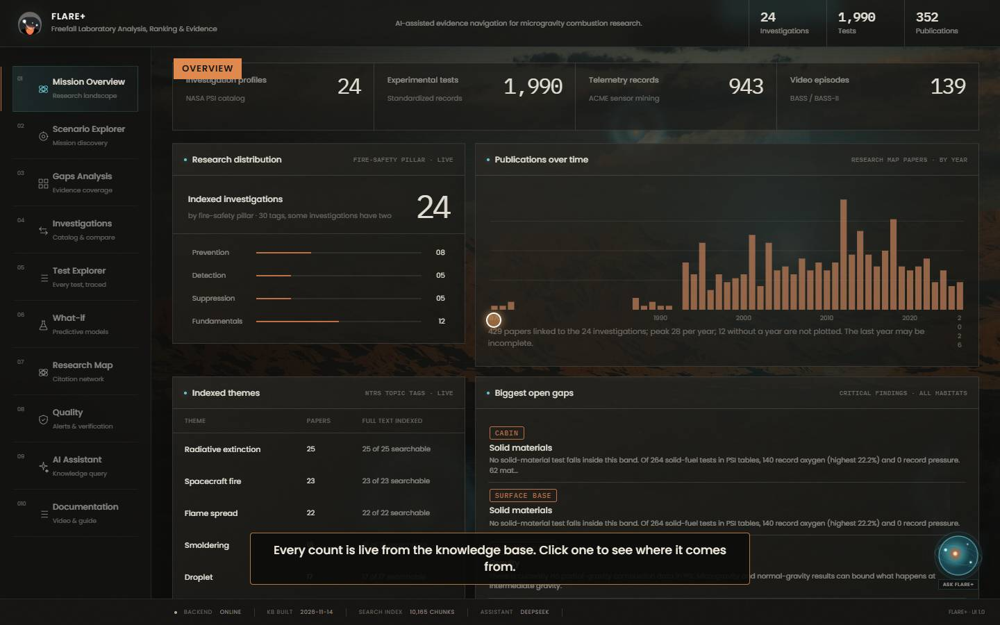
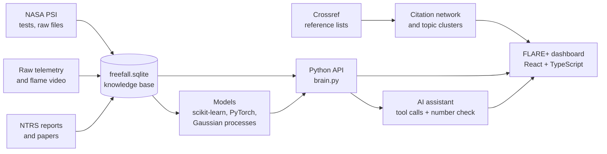

<div align="center">


# FLARE+

**Fire safety evidence for crewed habitats, built from NASA's microgravity combustion record.**

[**Live dashboard**](https://flame-in-freefall-wfbl.onrender.com/flare/) &nbsp;·&nbsp;
[**30-second demo**](https://drive.google.com/drive/folders/1jKcSlamKDWWHn-a5K19sNar_wqQvkuCj) &nbsp;·&nbsp;
[Indonesian README](docs/README.id.md)

NASA Space Apps Challenge 2026 · *Flame in Freefall: SI-Powered Fire Safety Insights*

<br>


<br>


<br>


</div>

<br>

<p align="center">
  <a href="https://flame-in-freefall-wfbl.onrender.com/flare/">
    
  </a>
</p>

## The problem

A fire on a spacecraft is not like a fire on Earth. Without gravity there is no rising hot air, so flames burn slower, cooler and in shapes nobody sees in a kitchen. The crew cannot step outside, and future habitats will make this harder: a Moon base is expected to run at around 30% oxygen and 70 kPa, a richer atmosphere than anything solid materials have been burned in on the ISS.

NASA has spent decades burning droplets, gas jets, plastics and fabrics in orbit. The results exist, but they are spread across 24 investigations in the Physical Sciences Informatics archive, raw sensor files, flame videos, spreadsheets and hundreds of papers. An engineer who wants to know *"has anyone tested this material at these conditions?"* has to dig through all of it by hand.

## What FLARE+ does

FLARE+ pulls that record into one place and turns it into answers you can check.

It reads every tabulated test, mines the raw telemetry and video NASA never tabulated, links each investigation to the papers behind it, and puts a dashboard and an AI assistant on top. Every number points back to the file or paper it came from. When the data cannot answer a question, the dashboard says so instead of guessing.

The dashboard is laid out as a story, from the big picture down to a single burn:

| | View | What it answers |
|---|---|---|
| **Orient** | Mission Overview | What is in the archive, and where are the biggest holes? |
| | Research Map | Which papers stand behind each experiment, and what do they cite? A citation network of the indexed papers and their references, grouped into topic clusters with k-means. |
| **Examine the evidence** | Gaps Analysis | What has never been tested for this habitat, and which next experiment would teach the most? |
| | Investigations | What did each of the 24 investigations burn, under which conditions? Compare up to four side by side. |
| | Test Explorer | What happened in one specific test? Click any value to see its source file and how it was derived. |
| | Quality | Where might the numbers be wrong, and how well do the models perform on held-out data? |
| **Predict & decide** | What-if | What would happen at conditions NASA did not test? Models for solid flammability across gravity, jet flame smoke points, gas flame ignition and droplet extinction, each with an uncertainty band. |
| | Scenario Explorer | Pick a cabin, a Moon or Mars base, a rover or a spacesuit, and see which investigations matter most for that atmosphere. |
| **Ask** | AI Assistant | Ask in plain English. Answers come from tools that query the data, cite papers, show equations and figures, and plot real measurements. The same conversation follows you on every page through the "Ask FLARE+" button. |
| **Experience** | Experiment Replay | Watch real FLEX droplet burns from the ISS replayed in 3D, second by second, with a note on which frames are measured and which are reconstructed. |
| | Documentation | A walkthrough video and a guide to every view. |

## By the numbers

| | |
|---|---|
| **24** | NASA combustion investigations (ACME, BASS, CFI, FLEX, Saffire, SPICE and more) |
| **1,990** | test rows unified into one schema |
| **943** | ACME tests whose flame outcome we recovered from raw 125 Hz sensor telemetry; on 320 tests NASA did label, our detector agrees 93.8% of the time (always guessing the majority would score 81.9%) |
| **139** | BASS and BASS-II flame episodes extracted from video |
| **55** | SPICE smoke points measured from raw NASA files |
| **352** | publications NASA links to these investigations, plus 695 NTRS documents and papers indexed as 10,165 searchable text chunks |
| **87.5%** | assistant score on a frozen hold-out question set (7 of 8), graded on whether every number matches a tool output |

## How it works



1. **Collect.** Scripts download the PSI investigation records, test tables and raw files, plus NTRS reports, keeping a SHA-256 manifest of every file.
2. **Unify and mine.** Test tables from 24 investigations become one schema in SQLite. Where NASA never tabulated an outcome, we extract it ourselves: ignition from thermocouple telemetry, flame episodes from BASS video, spread rates from Saffire imagery, smoke points from SPICE.
3. **Model.** Models are trained on ISS data and validated by test day, so a model never sees a test from the same day it is scored on. Each one knows the range it was trained on and refuses to answer outside it. A Gaussian process marks the flammability boundary and suggests the test that would shrink the uncertainty most.
4. **Explain.** The dashboard shows every result with its source. The assistant answers only through tools that read the knowledge base, and every number in its reply is checked against the tool output that produced it. Numbers with no source are flagged as unsupported.

## Run it locally

You need Python 3.11 and, to rebuild the frontend, Node.js 20 or newer.

```bash
# 1. Unpack the knowledge base (stored compressed because GitHub caps files at 100 MB)
python -c "import gzip,shutil; shutil.copyfileobj(gzip.open('kb/gold/freefall.sqlite.gz','rb'), open('kb/gold/freefall.sqlite','wb'))"

# 2. Install the server dependencies and build the paper search index
pip install -r requirements-server.txt
python scripts/retrieval.py build

# 3. Start the server
python scripts/brain.py serve
```

Open <http://127.0.0.1:8765/flare/>. Everything except free-form questions to the assistant works without an API key. To enable the assistant, set `LLM_PROVIDER=deepseek` with `DEEPSEEK_API_KEY`, or `LLM_PROVIDER=anthropic` with `ANTHROPIC_API_KEY`.

To work on the dashboard itself:

```bash
cd app/flare-src
npm install
npm run build      # writes the production build to app/flare/
```

With Docker:

```bash
docker build -t flare-plus .
docker run -p 8765:8765 -e LLM_PROVIDER=deepseek -e DEEPSEEK_API_KEY=your_key flare-plus
```

Deployment notes for the public instance, including rate limits and the read-only public mode, are in [docs/deploy.md](docs/deploy.md).

## Repository layout

| Path | Contents |
|---|---|
| `app/flare-src/` | Dashboard source (React, TypeScript, Vite) |
| `app/flare/` | Built dashboard served by the backend |
| `scripts/` | Data pipeline, models, the API server (`brain.py`) and the assistant (`assistant.py`) |
| `kb/gold/` | The knowledge base, ready-to-use CSV exports and a data dictionary |
| `analysis/` | Telemetry mining, video analysis, Saffire, SPICE, gravity bridge, retrieval and model results, each with its own method notes |
| `eval/` | Assistant evaluation sets, including the frozen hold-out set and its reports |
| `docs/` | Deployment guide and specifications |

## Read the numbers with care

- **Empty means not reported, never zero.**
- **Thermocouple telemetry stays in raw volts.** It is fine for comparing tests, but it is not a temperature and the dashboard never shows it as one.
- **There is no partial-gravity combustion data in PSI.** Moon and Mars answers are bounded by microgravity and Earth data plus a buoyancy-scaling model fitted on BASS-II, and they are labelled as model predictions.
- **No solid material has been tested in microgravity above 22% oxygen**, while a Moon base will run near 30%. This is the single most important gap FLARE+ points to.
- **Values derived from video and telemetry still need human review.** The Quality view lists them, most informative first.
- **The citation network is incomplete.** Only 222 of 438 indexed papers have an open reference list on Crossref.

Approaches we tried and dropped are written up in the `analysis/*/README.md` files, together with the reasons.

## Use of AI

We used AI tools in building this project, and we want to be clear about where.

- **Inside the product.** The assistant generates its answers live with DeepSeek V4 Pro (Claude can be used instead). It can only answer through tools that read our data, and its numbers are checked automatically before they are shown.
- **Code.** Parts of the code were written with the help of Claude Code and GitHub Copilot. Commits made with their help carry a `Co-Authored-By` line.
- **Design.** The first layout of the dashboard was drafted in Figma Make and then rebuilt and connected to the real data by hand.
- **Research.** AI assistants helped us search and summarise literature. Every figure we report was checked against the original NASA file or paper.

All machine learning models in the What-if and Quality views are our own, trained on NASA data, and documented with model cards in the dashboard.

## Data and credits

- [NASA Physical Sciences Informatics](https://psi.nasa.gov/physci/repo/search?q=combustion): investigation records, test tables and raw files, released under CC0.
- [NASA Technical Reports Server](https://ntrs.nasa.gov/): technical reports and papers, including the FLEX report [NASA/TP-2015-216046](https://ntrs.nasa.gov/citations/20150023456) behind Experiment Replay.
- [Crossref](https://www.crossref.org/): open reference metadata for the citation network.

FLARE+ is an independent project. It is not endorsed by or affiliated with NASA.
